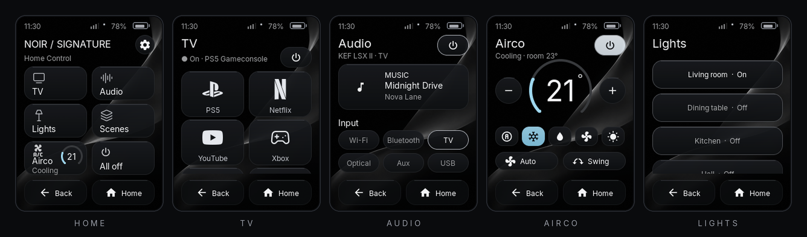
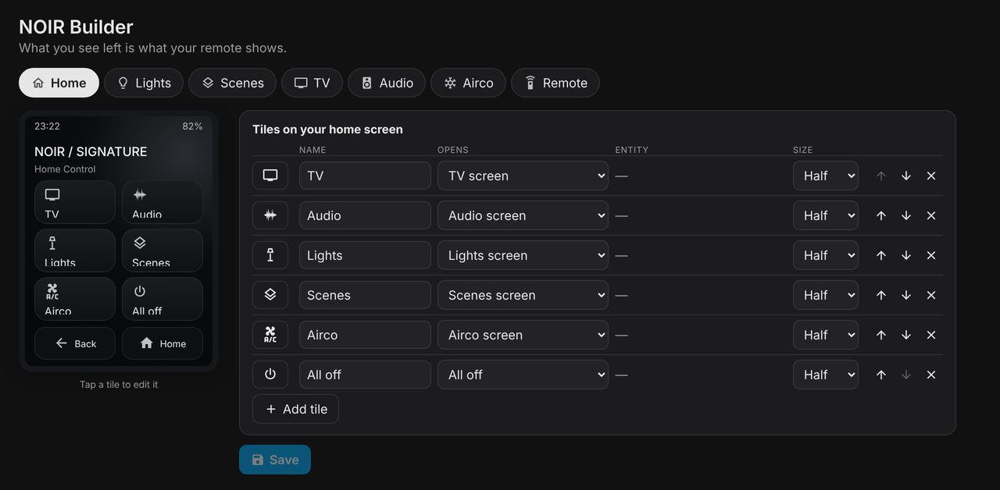
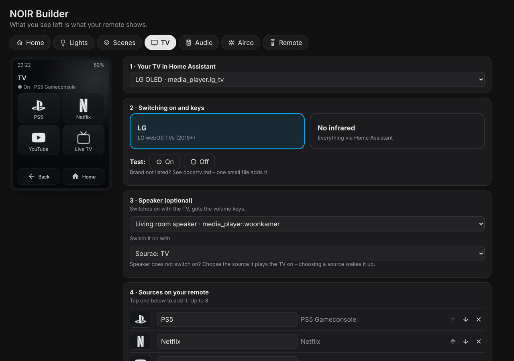
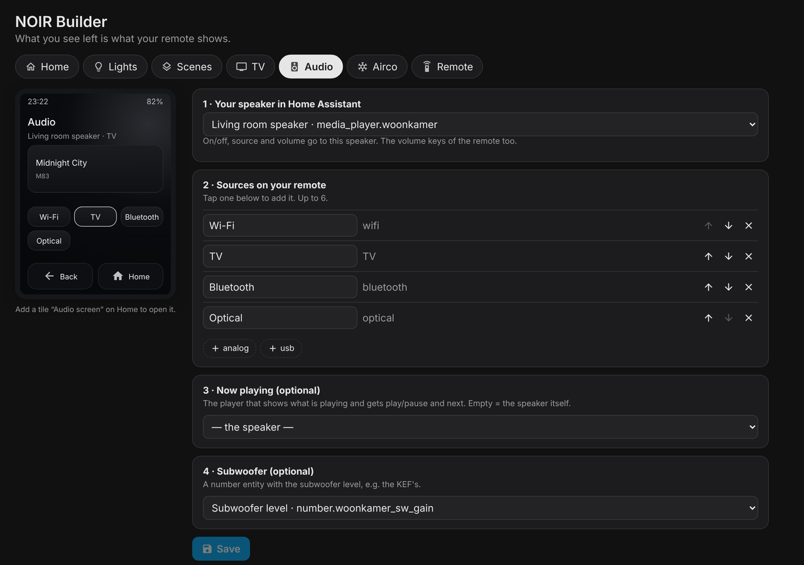
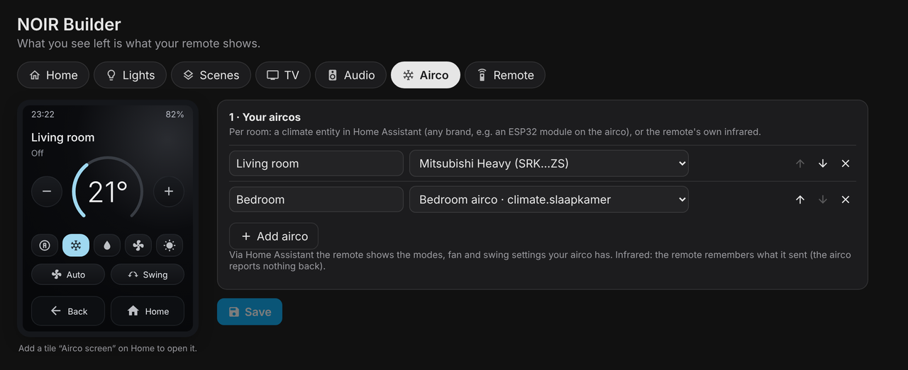
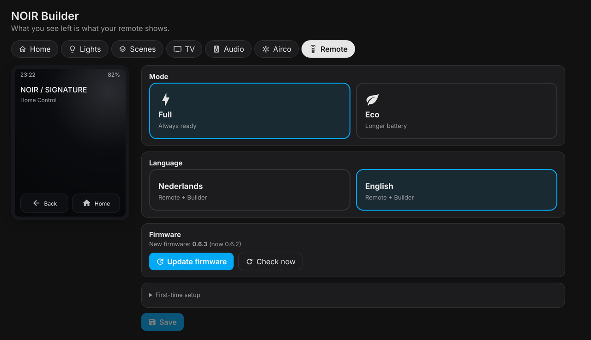
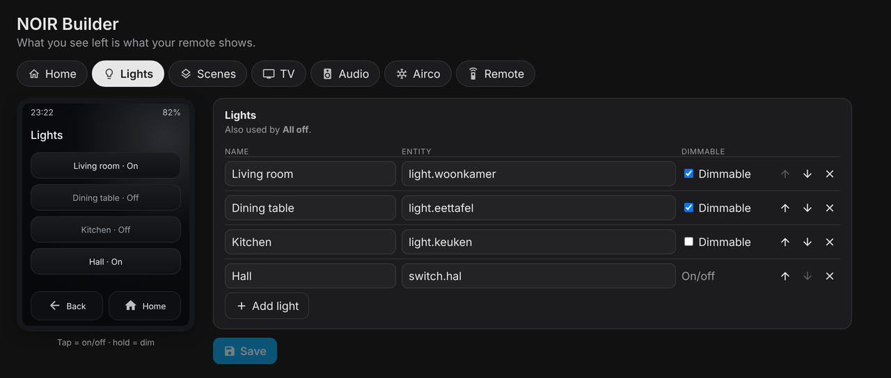
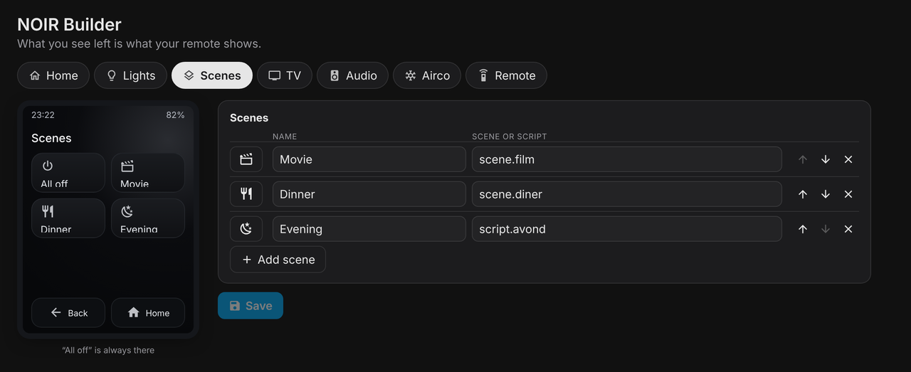

<p align="center"></p>

<p align="center">
  <b>NOIR turns the OpenRemote Rev6 into a calm, dark remote for your home.</b><br>
  Big tiles, few words, one tap. You set it up in Home Assistant – no code, no YAML editing.
</p>

<p align="center">
  <a href="https://ronsone.github.io/Noir_Remote/demo.html"><b>Try the demo</b></a> ·
  <a href="#setup--about-15-minutes"><b>Get started</b></a> ·
  <a href="#the-noir-builder">NOIR Builder</a> ·
  <a href="docs/tv.md">TV</a> ·
  <a href="#inside">How it works</a> ·
  <a href="#help-translate">Translate</a>
</p>

<br>

| ✦ **Simple** | ✦ **Yours** | ✦ **Open** |
|---|---|---|
| One screen per task. Text only where it helps. Nederlands, English, Deutsch, Français or Español. | Build your screens in the **NOIR Builder** – what you see is what the remote shows. | Any TV, speaker, light or airco in Home Assistant. One firmware for everyone, free, MIT licensed, every feature a small module. |

<p align="center"></p>

## What it does (version 0.7)

| | |
|---|---|
| **Home** | Big tiles. You choose what each one opens. |
| **TV** | Any TV in Home Assistant. Your inputs and apps as tiles with their logo. Keys by infrared. |
| **Lights** | Tap = on/off, hold = dim. |
| **Scenes** | Your scenes and scripts, plus *All off*. |
| **Audio** | Your speaker: on/off, its sources, volume, subwoofer and what is playing. Play/pause and next with the remote's keys. |
| **Airco** | One or more aircos (rooms): a dial around the temperature, modes, fan and swing. Any airco in Home Assistant, or the remote's own infrared (Mitsubishi Heavy). |
| **D-pad** | The screen you see decides: on the TV screen the arrows go to the TV, on the Airco screen they set temperature and mode, everywhere else a focus ring moves over the buttons and sliders – OK presses, hold OK = long press, left/right moves a slider. |
| **Settings** | On the remote: **Full** (always ready) or **Eco** (longer battery), four skins, Wi-Fi, a button test. |

What comes next – updating locally through Home Assistant, more remotes, Italian, heating – is in the [roadmap](docs/roadmap.md). Which tiles your home screen shows is up to you: add and remove them in the NOIR Builder.

**Try it first:** the **[demo](https://ronsone.github.io/Noir_Remote/demo.html)** shows the remote's screens in your browser, with sample data – tap the tiles or use the D-pad under the screen (or the arrow keys and Enter on your keyboard).

## Setup – about 15 minutes

**You need:** an OpenRemote Rev6 with a USB-C cable that carries data (not a charge-only cable) · Home Assistant with [HACS](https://hacs.xyz) · a PC or Mac with Chrome or Edge.
No programming, no files, no keys to copy.

### 1 · Home Assistant
1. Click this button – it opens HACS in your own Home Assistant with NOIR Remote filled in:

   [](https://my.home-assistant.io/redirect/hacs_repository/?owner=ronsone&repository=Noir_Remote&category=integration)

   Press **Download** (bottom right) → **Download**. Then restart Home Assistant: *Settings → System → ⏻ Restart*.
2. Click this button and press **Submit**:

   [](https://my.home-assistant.io/redirect/config_flow_start/?domain=noir_remote)

   *(Or: Settings → Devices & services → Add integration → NOIR Remote.)*

<details><summary>Without HACS</summary>

Install the **Samba share** add-on. The config folder of Home Assistant then opens on your PC (Windows Explorer: `\\homeassistant.local\config`).
Download this page (**Code → Download ZIP**), unzip it and drag the folder `custom_components/noir_remote` into `config/custom_components`. Restart Home Assistant.
</details>

### 2 · Firmware – from your browser
1. Connect the remote to your PC with the USB-C cable.
2. Open the **[NOIR installer](https://ronsone.github.io/Noir_Remote/)** in Chrome or Edge, press **Installeren** and choose the remote's port.
   It takes about two minutes.

### 3 · Wi-Fi
The remote starts its own Wi-Fi network. Connect your phone to **noir-remote setup**, a page opens: choose your Wi-Fi and fill in the password (2.4 GHz Wi-Fi).

### 4 · Done
Within a minute Home Assistant adds the remote by itself – the encryption key, the actions and the connection to NOIR Remote are all set up for you.
You find it under *Settings → Devices & services → ESPHome*.

### 5 · Your screens
Open **NOIR Builder** in the sidebar and make the remote yours – see below.

## The NOIR Builder

The NOIR Builder is the page in Home Assistant's sidebar where you build your remote. No code, no files: you pick things from lists.

- **Left: the preview.** What you see is what the remote shows.
- **Top: one tab per screen.** Change something and press **Save** – the remote picks it up within seconds (it gets a nudge from Home Assistant; otherwise within 15 minutes).
- Everything is in Nederlands, English, Deutsch, Français or Español – switch under *Remote → Language*; the remote follows. Your language missing? See [Help translate](#help-translate).

<p align="center"></p>

| Tab | What you do there |
|---|---|
| **Home** | The tiles on your home screen. **Add tile**, choose what it **opens** (TV, Audio, Lights, Scenes, Airco, All off, settings – or switch one device, or run a scene/script), give it a name and icon, half or full width. Reorder or remove them with the arrows and ×. |
| **Lights** | Add your lamps. Tap = on/off, hold = dim (for dimmable lights). |
| **Scenes** | Your scenes and scripts as tiles. *All off* is always there. |
| **TV** | 1 your TV · 2 its brand for infrared – press **Test · On** to check · 3 your speaker (optional, with *Switch it on with: source* for speakers that wake up that way) · 4 tap the inputs and apps you want; logos are picked for you. Your TV must be on to see its inputs. More in [docs/tv.md](docs/tv.md). |
| **Audio** | 1 your speaker · 2 tap its sources (up to 6), rename them · 3 *Now playing* from another player (optional, e.g. Music Assistant) · 4 a subwoofer level (optional). |
| **Airco** | Per room: a name and how it is controlled – a **climate entity** in Home Assistant (any brand) or the remote's **own infrared** (Mitsubishi Heavy). Up to 4 rooms; on the remote you switch between them. |
| **Remote** | Mode (**Full** / **Eco**), language, **Firmware** (version, **Check now**, **Update firmware**, channel **Stable** or **Test**) and *First-time setup* with a link to the installer. |

A screen only works once it has a tile on **Home** – e.g. add a tile *Audio screen* after setting up Audio.

<details><summary><b>Screenshots of every tab</b></summary>

| | |
|---|---|
| **TV** – your TV, brand for infrared, speaker, sources with logos<br> | **Audio** – speaker, sources, now playing, subwoofer<br> |
| **Airco** – rooms, each via Home Assistant or infrared<br> | **Remote** – mode, language, firmware updates<br> |
| **Lights** – your lamps, dimmable or on/off<br> | **Scenes** – scenes and scripts as tiles<br> |

</details>

## Updating

Your screens and settings stay.

- **Remote:** *NOIR Builder → Remote → Firmware* → **Update firmware**. The remote downloads the new firmware itself and restarts. (Home Assistant also shows the update under *Settings → Updates*.)
  **Stable** (default) gets released versions only. **Test** gets the newest build first – for testers; switch back to Stable any time.
- **Home Assistant:** HACS shows the update – press **Update**, then restart Home Assistant.

**Coming from version 0.2** (with a `secrets.yaml`)? Install the new firmware once with the [installer](https://ronsone.github.io/Noir_Remote/) via USB and set up Wi-Fi (steps 2 and 3).
In Home Assistant, delete the old *noir-remote* under ESPHome first; the new one is added by itself.

<details><summary>Build the firmware yourself (developers)</summary>

With Python 3: `pip install esphome`, then in the folder `firmware`: `esphome run noir-remote.yaml`.
GitHub checks that the firmware builds on every change in `firmware/` (`.github/workflows/firmware.yml`). **Run workflow** publishes the newest build to the **test** channel. The **stable** channel only changes when you **release**:
raise `substitutions: version` in `noir-remote.yaml`, then *GitHub → Releases → Draft a new release*, tag `v` + that version (e.g. `v0.7.2`) → **Publish**.
Only then do the installer and the remotes on Stable get it.
</details>

## Inside

```
firmware/
  noir-remote.yaml    the remote = core + boards/rev6.yaml (name, version, update channel)
  core/               the same on every NOIR device – the core knows no boards, only capabilities
    noir-core.yaml    Home Assistant link, updates, Wi-Fi setup, fonts, LVGL
    noir-ui.h         the screens (shared with the simulator)
    mdi_icons.h       the icons NOIR Builder offers (tools/check_icons.py keeps the font in sync)
    noir-app.h        starts the modules
    modules/          one file per feature: core, home, lights, scenes, tv, audio, airco, nav
  boards/rev6.yaml    OpenRemote Rev6 hardware: display, touch, keys, infrared, battery + its capabilities
  components/         Rev6 drivers (from ESPHomeRemote by Aggro600)
  logos/              logos for TV sources (made by tools/make_logos.py)
custom_components/noir_remote/
  NOIR Builder panel, config + state endpoints for the remote
  link.py             links the remote by itself (confirm, actions, host + key)
  frontend/           the NOIR Builder (one file, noir-builder.js)
  profiles.json       infrared codes per TV brand
  languages/          language packs (de, fr, es) – texts of NOIR Builder and the remote
  logos.json          which source name gets which logo
site/                 the installer page and the demo (GitHub Pages)
simulator/            all screens on your PC (SDL2 + LVGL), same screen code as the firmware
tools/                check_icons.py, check_languages.py, make_sim_font.py, make_logos.py, make_brand.py
```

**New feature = new module.** Copy `firmware/core/modules/scenes.h`, give it a name, handle its actions/keys, add it in `noir-app.h`.

## Help translate

NOIR speaks Nederlands, English, Deutsch, Français and Español. Want it in **your** language, or found a better word? You don't need to code:

1. Open **[languages/en.json](custom_components/noir_remote/languages/en.json)** – every text of NOIR Builder and the remote in one file.
2. Translate the values (not the keys) and keep the remote's texts short.
3. Send it in with the **[translation form](https://github.com/ronsone/Noir_Remote/issues/new?template=translation.yml)** – paste or attach your file. Or open a pull request.

A new language needs no new firmware: it comes with the next update of the integration. Details in [docs/languages.md](docs/languages.md).

## Credits

Hardware: [OpenRemote Rev6](https://github.com/LORDSn1per/OpenRemote-Hardware). Display, touch, key and battery drivers come from [ESPHomeRemote by Aggro600](https://github.com/Aggro600/ESPHomeRemote). Font: Inter (OFL). Icons: Material Design Icons, Lucide (ISC). Source logos: [Simple Icons](https://simpleicons.org) (CC0) – trademarks belong to their owners and only show which source a tile opens.

License: MIT
