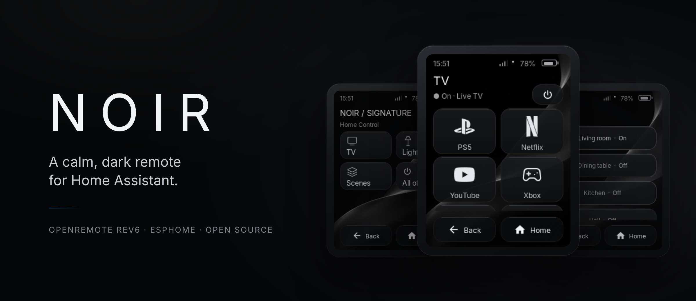

<p align="center"></p>

<p align="center">
  <b>NOIR turns the OpenRemote Rev6 into a calm, dark remote for your home.</b><br>
  Big tiles, few words, one tap. You set it up in Home Assistant – no code, no YAML editing.
</p>

<p align="center">
  <a href="#setup--about-30-minutes-most-of-it-waiting-for-the-first-build"><b>Get started</b></a> ·
  <a href="docs/tv.md">TV</a> ·
  <a href="#inside">How it works</a>
</p>

<br>

| ✦ **Simple** | ✦ **Yours** | ✦ **Open** |
|---|---|---|
| One screen per task. Text only where it helps. Nederlands or English. | Build your screens in the **NOIR Builder** – what you see is what the remote shows. | Any TV in Home Assistant. Free, MIT licensed, every feature a small module. |

<p align="center"></p>

## What it does (version 0.2)

| | |
|---|---|
| **Home** | Big tiles. You choose what each one opens. |
| **TV** | Any TV in Home Assistant. Your inputs and apps as tiles with their logo. Keys by infrared. |
| **Lights** | Tap = on/off, hold = dim. |
| **Scenes** | Your scenes and scripts, plus *All off*. |
| **Modes** | **Full** – always ready. **Eco** – longer battery. |

Audio, Netflix and Airco come next – each as its own module.

## Setup – about 45 minutes, most of it waiting for the first build

**You need:** an OpenRemote Rev6 with a USB-C cable that carries data (not a charge-only cable) · Home Assistant with [HACS](https://hacs.xyz) · a Windows PC, Mac or Linux PC.
No programming needed.

### 1 · Home Assistant
1. Click this button – it opens HACS in your own Home Assistant with NOIR Remote filled in:

   [](https://my.home-assistant.io/redirect/hacs_repository/?owner=ronsone&repository=Noir_Remote&category=integration)

   Press **Download** (bottom right) → **Download**. Then restart Home Assistant: *Settings → System → ⏻ Restart*.
2. Click this button and press **Submit**:

   [](https://my.home-assistant.io/redirect/config_flow_start/?domain=noir_remote)

   *(Or: Settings → Devices & services → Add integration → NOIR Remote.)*
3. Open **NOIR Builder** (sidebar) → tab *Remote* → *First-time setup*: fill in your Wi-Fi and press **Download secrets.yaml**.

<details><summary>Without HACS</summary>

Install the **Samba share** add-on. The config folder of Home Assistant then opens on your PC (Windows Explorer: `\\homeassistant.local\config`).
Download this page (**Code → Download ZIP**), unzip it and drag the folder `custom_components/noir_remote` into `config/custom_components`. Restart Home Assistant.
</details>

### 2 · Firmware
The firmware is the software that runs on the remote. Your PC builds it once and puts it on the remote over USB.

**2.1 · Download the firmware and put secrets.yaml in place**
On this page: **Code → Download ZIP**. Unzip it, for example in *Downloads*. You get a folder `Noir_Remote-main`.
Move the downloaded `secrets.yaml` into `Noir_Remote-main/firmware` – next to `noir-remote.yaml`.
It holds your Wi-Fi and the keys of your remote: keep it to yourself.

**2.2 · Install Python** (once – skip if you have it)
ESPHome, the tool that builds the firmware, runs on Python.
- **Windows:** download Python from [python.org/downloads](https://www.python.org/downloads/) and run it.
  On the first screen tick **Add python.exe to PATH**, then *Install Now*.
- **Mac:** download Python from [python.org/downloads](https://www.python.org/downloads/) and run the installer.
- **Linux:** Python is already there.

**2.3 · Open a terminal in the firmware folder**
A terminal is a window where you type commands. It must be opened *in* the folder `firmware`, otherwise it can't find the files.
- **Windows:** open the folder `firmware` in Explorer. Click in the address bar at the top, type `cmd` and press Enter.
- **Mac:** in Finder, right-click the folder `firmware` → *New Terminal at Folder*.
  (Not in the menu? *System Settings → Keyboard → Keyboard Shortcuts → Services → Files and Folders* → tick *New Terminal at Folder*.)
- **Linux:** right-click in the folder `firmware` → *Open in Terminal*.

Check: type `dir` (Windows) or `ls` (Mac/Linux) and press Enter. You should see `noir-remote.yaml` and `secrets.yaml`.

**2.4 · Install ESPHome** (once)
Copy this line into the terminal and press Enter. It downloads ESPHome onto your PC – takes a minute.

| Windows | Mac / Linux |
|---|---|
| `python -m pip install esphome` | `python3 -m pip install esphome` |

**2.5 · Build and flash**
Connect the remote to your PC with the USB-C cable. Then:

| Windows | Mac / Linux |
|---|---|
| `python -m esphome run noir-remote.yaml` | `python3 -m esphome run noir-remote.yaml` |

What happens:
1. ESPHome builds the firmware. **The first time this takes 10–20 minutes** – lots of text scrolls by, that is normal.
2. It asks where to send it. Choose the **USB port** – on Windows `COM3` or similar, on Mac `/dev/cu.usbmodem…`, on Linux `/dev/ttyACM0`.
   Type its number and press Enter.
3. The remote restarts with NOIR on its screen and connects to your Wi-Fi. You can close the terminal.

Later updates are quick and need no cable: run the same command and choose **Over The Air** (your remote's name).

**Something wrong?**

| You see | Do this |
|---|---|
| `No such file or directory: 'noir-remote.yaml'` | The terminal is not in the folder `firmware`. Go back to 2.3. |
| `'python' is not recognized` (Windows) | Python is not on PATH. Run the Python installer again → *Modify* → tick *Add Python to environment variables*. Close and reopen the terminal. |
| `externally-managed-environment` (Linux) | Install with `pipx install esphome`, then use `esphome run noir-remote.yaml`. |
| `No such file or directory: 'secrets.yaml'` or `Secret ... not defined` | `secrets.yaml` is missing or not next to `noir-remote.yaml`. Go back to 2.1. |
| No USB port in the list | Try another cable (many only charge) or another USB port. On Linux: `sudo usermod -aG dialout $USER`, then log out and in. |
| The remote doesn't connect to Wi-Fi | Check the Wi-Fi name and password in `secrets.yaml` (capitals count). The remote needs 2.4 GHz Wi-Fi. |

### 3 · Connect
Nothing to do: about a minute after the remote starts, NOIR Remote adds it to Home Assistant (ESPHome) by itself, key included.
You find it under *Settings → Devices & services → ESPHome*.
*Did Home Assistant already show **New device found** and ask for a key? You can ignore it – it disappears once the remote is added.*

### 4 · Your screens
Open **NOIR Builder** in the sidebar. Each tab is one screen, the preview shows your remote. Press **Save** – the remote updates in seconds.

**TV in four steps:** choose your TV → choose its brand and press **Test** → (optional) your speaker → tap the inputs and apps you want. Logos are picked for you. More in [docs/tv.md](docs/tv.md).

## Updating to a new version

Your screens and settings stay.

1. **Home Assistant:** HACS shows the update – press **Update**, then restart Home Assistant.
2. **Remote:** download this page again (**Code → Download ZIP**), move your `secrets.yaml` into the new `firmware` folder,
   open a terminal there (step 2.3) and run the build command from step 2.5. Choose **Over The Air** – no cable needed.

## Inside

```
firmware/
  noir-remote.yaml    hardware + ESPHome setup
  noir-ui.h           the screens (shared with the simulator)
  noir-app.h          starts the modules
  modules/            one file per feature: core, home, lights, scenes, tv
  logos/              logos for TV sources (made by tools/make_logos.py)
custom_components/noir_remote/
  NOIR Builder panel, config + state endpoints for the remote
  profiles.json       infrared codes per TV brand
  logos.json          which source name gets which logo
simulator/            all screens on your PC (SDL2 + LVGL)
```

**New feature = new module.** Copy `firmware/modules/scenes.h`, give it a name, handle its actions/keys, add it in `noir-app.h`.

## Credits

Hardware: [OpenRemote Rev6](https://github.com/LORDSn1per/OpenRemote-Hardware). Display, touch, key and battery drivers come from [ESPHomeRemote by Aggro600](https://github.com/Aggro600/ESPHomeRemote). Font: Inter (OFL). Icons: Material Design Icons, Lucide (ISC). Source logos: [Simple Icons](https://simpleicons.org) (CC0) – trademarks belong to their owners and only show which source a tile opens.

License: MIT
