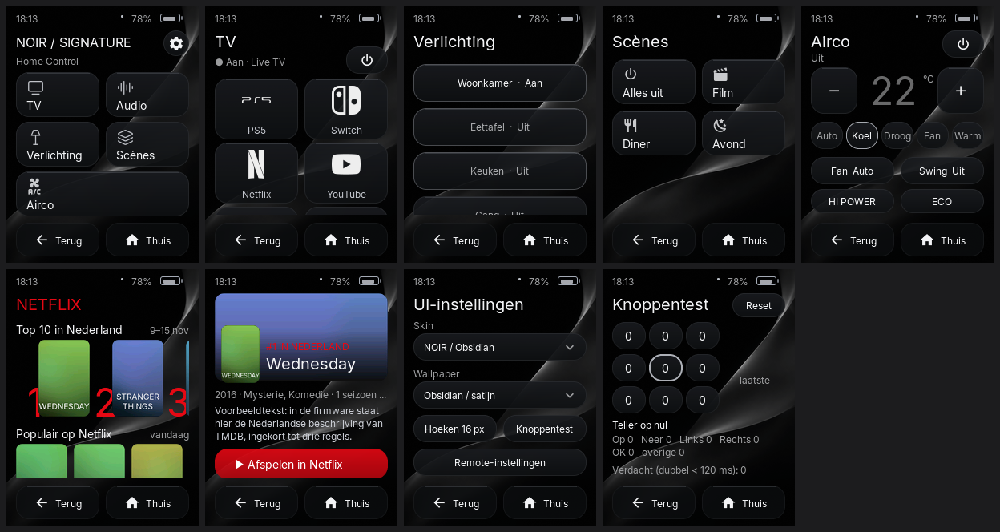

# NOIR simulator for ESPHomeRemote

Runs the NOIR screens of the ESPHomeRemote (OpenRemote Rev6, 240 × 320) in a window on your PC.
It uses **the same screen code as the firmware** – it compiles `../firmware/noir-ui.h` directly –
on LVGL 9.5 + SDL2. Change the firmware, rebuild the simulator, see the result. Home Assistant, the TV,
IR and the internet are simulated: whatever the remote would send to Home Assistant is printed in the console.



## Screens

NOIR Thuis (home, tiles from the configurator) · TV (apps, power) · Verlichting (lights: tap = on/off, long press =
dimmer) · Scènes (incl. built-in "Alles uit") · Airco (Mitsubishi Heavy IR: temperature, mode, fan, swing, HI POWER,
ECO) · Netflix dashboard (Top 10 NL, Popular, Recently started, detail screen) · UI settings (skin, wallpaper, corner
radius) · Audio (speaker, inputs, volume, sub) · Muziek via Music Assistant (now playing, playlists, recent) ·
Search (letter wheel and keyboard) · Knoppentest (button test).

Environment variables: `NOIR_README=1` (abstract posters), `NOIR_GEEN_WIFI=1` (no Wi-Fi).

## Build

Run the commands below **inside the `simulator` folder** of this repo.

You need a C/C++ compiler, CMake, git and SDL2. LVGL 9.5 is downloaded automatically
(or point to your own copy with `-DLVGL_DIR=/path/to/lvgl`).

**Windows (MSYS2 UCRT64 shell)**
```bash
pacman -S --needed git mingw-w64-ucrt-x86_64-gcc mingw-w64-ucrt-x86_64-cmake mingw-w64-ucrt-x86_64-ninja mingw-w64-ucrt-x86_64-SDL2
cmake -S . -B build -G Ninja -DCMAKE_BUILD_TYPE=Release
cmake --build build
./build/noir-simulator.exe
```

**Linux (Debian/Ubuntu)**
```bash
sudo apt install build-essential cmake git libsdl2-dev
cmake -S . -B build -DCMAKE_BUILD_TYPE=Release && cmake --build build -j
./build/noir-simulator
```

**macOS**
```bash
brew install cmake sdl2
cmake -S . -B build -DCMAKE_BUILD_TYPE=Release && cmake --build build -j
./build/noir-simulator
```

## Controls

| Input | On the remote |
| --- | --- |
| Mouse | Finger (tap, long press, swipe) |
| Arrow keys / Enter | D-pad / OK |
| Backspace or Esc | Back |
| H | Home |
| Space / S / , / . | Play-pause / Stop / Rewind / Fast-forward (on the Netflix screens) |
| + / - / M | Volume up / down / mute (KEF) |
| P | Screenshot (`noir-<n>.bmp`) |
| Q | Quit |

`./noir-simulator --demo` walks through all screens, saves a screenshot of each (`demo-*.bmp`) and exits.

## How NOIR sits on top of the Aggro600 firmware

- NOIR is a set of full-screen LVGL layers on `page_home` (one per screen); the Aggro600 pages stay untouched below.
  Objects carry `LV_OBJ_FLAG_USER_4`, so the Aggro600 skins leave them alone.
- Tiles, lights and scenes come from configurator menu pages (`noir`, `noir_licht`, `noir_scenes`), so they change
  without recompiling. Taps call `noir::st().actie(code)`; in the firmware that is `tasten::noir_actie` in
  `esphomeremote-keys.h`, here a simplified copy in `src/main.cpp`.
- Physical keys go through `noir::kef::taste` (volume → KEF) and `noir::tv::taste` (D-pad/OK → `webostv.button`,
  airco, button test, Netflix media keys) before the key configurator.
- Netflix: the integration (`netflix.py`) combines the official Netflix Top 10 (Tudum), TMDB (posters, text, Popular)
  and Wikidata (Netflix title number, P1874); the remote fetches a plain text list and 64 × 96 RGB565 posters from
  Home Assistant, and *Play in Netflix* calls `esphomeremote.tv_app`, which launches the title on the LG.

## Credits and licences

- [LVGL](https://lvgl.io) (MIT, downloaded at build time), [ArduinoJson](https://arduinojson.org) (MIT, `inc/`).
- Inter font (SIL OFL 1.1, `fonts/Inter-OFL.txt`), Material Design Icons subset (Pictogrammers, Apache 2.0),
  Lucide icons (ISC, `assets/LUCIDE-LICENSE.txt`).
- The posters are generated placeholders; the real ones come from TMDB in the firmware. App logos belong to their
  owners and are only used to show the TV screen.
