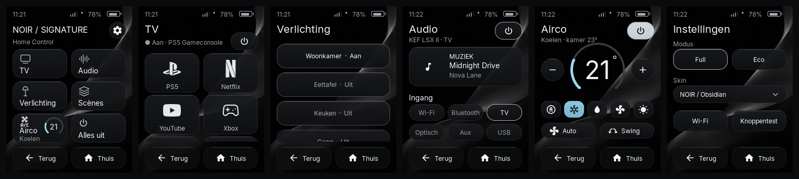

# NOIR simulator

Runs the NOIR screens of the remote (OpenRemote Rev6, 240 × 320) in a window on your PC.
It uses **the same screen code as the firmware** – it compiles `../firmware/core/noir-ui.h` directly –
on LVGL 9.5 + SDL2. Change the firmware, rebuild the simulator, see the result. Home Assistant, the TV,
IR and the internet are simulated: whatever the remote would send to Home Assistant is printed in the console.



## Screens

Home (tiles from NOIR Builder) · TV (sources with logos, power) · Lights (tap = on/off, hold = dimmer) · Scenes
(incl. "All off") · Audio (speaker, sources, volume, subwoofer, now playing) · Airco (dial, modes, fan, swing –
Mitsubishi Heavy infrared) · Settings (mode, skin) · Button test.

`--demo` walks every screen and saves a screenshot of each (`demo-*.bmp`); `--en` shows the English screens.
Without a screen (CI, servers): `SDL_VIDEODRIVER=dummy ./build/noir-simulator --demo`.

## Build

Run the commands below **inside the `simulator` folder** of this repo.

You need a C/C++ compiler, CMake, git and SDL2. LVGL 9.5 is downloaded automatically
(or point to your own copy with `-DLVGL_DIR=/path/to/lvgl`).

**Windows (MSYS2 UCRT64 shell)**
```bash
pacman -S --needed git mingw-w64-ucrt-x86_64-gcc mingw-w64-ucrt-x86_64-cmake mingw-w64-ucrt-x86_64-ninja mingw-w64-ucrt-x86_64-SDL2
cmake -S . -B build -G Ninja -DCMAKE_BUILD_TYPE=Release
cmake --build build
./build/noir-simulator.exe
```

**Linux (Debian/Ubuntu)**
```bash
sudo apt install build-essential cmake git libsdl2-dev
cmake -S . -B build -DCMAKE_BUILD_TYPE=Release && cmake --build build -j
./build/noir-simulator
```

**macOS**
```bash
brew install cmake sdl2
cmake -S . -B build -DCMAKE_BUILD_TYPE=Release && cmake --build build -j
./build/noir-simulator
```

## Controls

| Input | On the remote |
| --- | --- |
| Mouse | Finger (tap, long press, swipe) |
| Arrow keys / Enter | D-pad / OK |
| Backspace or Esc | Back |
| H | Home |
| Space | Play/pause (Audio) |
| + / - / M | Volume up / down / mute (the speaker) |
| P | Screenshot (`noir-<n>.bmp`) |
| Q | Quit |

`./noir-simulator --demo` walks through all screens, saves a screenshot of each (`demo-*.bmp`) and exits.

## How it fits together

- NOIR is a set of full-screen LVGL layers on `page_home`, one per screen; the status bar moves to the visible one.
- `firmware/core/noir-ui.h` only builds and shows the screens. In the firmware, modules (`firmware/core/modules/*.h`) fill in the
  data from Home Assistant and handle taps and keys; here `src/main.cpp` is a small stand-in with sample data.
- Taps call `noir::st().actie(code)` – in the firmware `noirapp::action`, here `action()` in `src/main.cpp`.
- The icon font `fonts/mdi20.c` is made from the firmware's glyph list: `python3 tools/make_sim_font.py`.

## Credits and licences

- [LVGL](https://lvgl.io) (MIT, downloaded at build time), [ArduinoJson](https://arduinojson.org) (MIT, `inc/`).
- Inter font (SIL OFL 1.1, `fonts/Inter-OFL.txt`), Material Design Icons subset (Pictogrammers, Apache 2.0),
  Lucide icons (ISC, `assets/LUCIDE-LICENSE.txt`).
- App logos belong to their owners and are only used to show the TV screen.

## In the browser (the NOIR phone panel)

The same simulator builds to WebAssembly with [Emscripten](https://emscripten.org); Home Assistant serves it as the
sidebar panel **NOIR** (`custom_components/noir_remote/frontend/web/`, loaded by `noir-phone.js`).

```bash
emcmake cmake -S simulator -B build-web -DCMAKE_BUILD_TYPE=Release
cmake --build build-web
cp build-web/noir-simulator.{js,wasm,data} custom_components/noir_remote/frontend/web/
```

In the browser it takes its configuration and the states of its lamps and TV from Home Assistant
(`noir_web_config`, `noir_web_states`) and sends its actions back (`Module.noirHa`). Without Emscripten's network
access to GitHub archives, point it at a git clone of SDL2: `EMCC_LOCAL_PORTS=sdl2=/path/to/SDL` (tag `release-2.32.10`).
